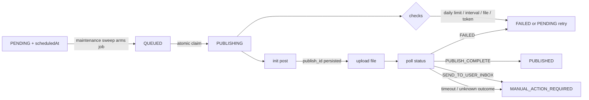

# TikTok Scheduler

Self-hosted queue for TikTok video publishing: upload a batch of videos, describe how often you want
to post, and a background worker publishes them through the official TikTok Content Posting API —
without keeping a browser open.

- **Scheduling engine** — interval, fixed-time, smart distribution and fully custom schedules with
  daily limits, minimum interval, active hours/days and timezone handling.
- **Durable queue** — SQLite is the source of truth, Redis/BullMQ is the transport; a worker restart
  or Redis flush is repaired by the next sweep.
- **Honest publishing** — a post is only marked published after TikTok confirms it. An attempt whose
  outcome is unknown is never retried blindly; it is surfaced as *manual action required*.

## Requirements

- Node.js 24 (or Docker)
- Redis 7 (queue, locks, heartbeat)
- FFmpeg / FFprobe (video metadata + thumbnails, worker only)

## Local development

```bash
npm install
cp .env.example .env            # set AUTH_SECRET and TOKEN_ENCRYPTION_KEY
npx prisma migrate deploy       # create data/tiktok-scheduler.db
npx prisma generate

npm run dev                     # web on http://localhost:3000
npm run dev:worker              # worker in a second terminal (needs Redis on 6379)
```

Register the first account in the UI, then connect a TikTok account. With `TIKTOK_API_MODE=mock` the
whole pipeline runs against a local fake API (see `packages/tiktok`), which is how the publishing
worker is exercised in tests.

Generate the two secrets with:

```bash
node -e "console.log(require('crypto').randomBytes(32).toString('hex'))"   # run twice
```

### Useful commands

| Command | Purpose |
|---|---|
| `npm run typecheck` | TypeScript across web, worker and packages |
| `npm run lint` | ESLint |
| `npm test` | Unit + integration tests (the publishing e2e needs Redis and FFmpeg) |
| `npm run build` | Production build of the web app |
| `npm run prisma:migrate` | Create a migration after editing `prisma/schema.prisma` |

## Docker Compose

```bash
cp .env.example .env         # DATABASE_URL=file:/app/data/tiktok-scheduler.db
docker compose up -d --build
docker compose logs -f worker
```

Services: `redis`, `migrate` (runs `prisma migrate deploy` once), `web`, `worker`, `nginx`. Only nginx
publishes ports; the app is reachable on `http://<host>/` (TLS block in `nginx/nginx.conf`).

Volumes: `./data` (SQLite database + backups) and `./storage` (videos, thumbnails). Both must live on
a local filesystem — SQLite locking is not reliable on network mounts.

The containers run as root inside the image so that bind-mounted `./data` and `./storage` work without
UID juggling. Harden by switching to a fixed UID once you control those directories.

## Environment

| Variable | Default | Notes |
|---|---|---|
| `DATABASE_URL` | `file:../data/tiktok-scheduler.db` | Use an absolute path in Docker |
| `REDIS_URL` | `redis://127.0.0.1:6379` | |
| `AUTH_SECRET`, `TOKEN_ENCRYPTION_KEY` | — | Required; tokens are encrypted with AES-256-GCM |
| `STORAGE_ROOT` | `./storage` | Videos + thumbnails |
| `MAX_UPLOAD_SIZE_MB` | `287` | TikTok's per-file ceiling |
| `WORKER_CONCURRENCY` | `2` | Concurrent publish jobs |
| `SCHEDULE_SCAN_INTERVAL_MS` | `30000` | Reconciliation sweep between SQLite and Redis |
| `PUBLISH_JOB_TIMEOUT_MS` | `600000` | Polling deadline for one publish attempt |
| `PUBLISH_MAX_RETRIES` | `3` | Retries for pre-init failures (never after a publish id exists) |
| `BACKUP_RETAIN` / `BACKUP_INTERVAL_HOURS` | `7` / `24` | `VACUUM INTO` snapshots in `data/backups` |
| `TIKTOK_API_MODE` | `mock` | `live` requires an approved TikTok app |
| `TELEGRAM_BOT_TOKEN`, `TELEGRAM_CHAT_ID` | — | Optional notification channel |

## How publishing works



Invariants the worker relies on:

1. **One claim per post.** `QUEUED/PENDING → PUBLISHING` is a conditional `updateMany` plus a Redis
   lease, so two workers can never publish the same row.
2. **The publish id is stored before the upload.** From that moment the attempt is resumable by
   polling — never by creating a second post.
3. **Unknown outcome → manual.** A crash or network failure before a publish id exists marks the post
   `MANUAL_ACTION_REQUIRED` and notifies the user instead of risking a duplicate.
4. **Limits are re-checked at publish time.** Schedule generation is a plan; the worker verifies daily
   limits, minimum interval and file existence against live data immediately before publishing.

State machine: `DRAFT → READY → PENDING → QUEUED → PUBLISHING → PUBLISHED | FAILED |
MANUAL_ACTION_REQUIRED | CANCELLED`.

## TikTok integration

The app uses OAuth 2.0 and the official Content Posting API (`video.publish` / `video.upload`
scopes). Two publish methods are implemented: **Direct Post** and **Upload as draft** (inbox).

Before live publishing works you need: an approved TikTok developer app, the content posting scopes
granted through their audit, a verified domain for the redirect URI, and an account whose creator
settings allow the chosen privacy level. Until then the scheduler refuses to guess — privacy levels
are validated against `creator_info`, and direct post availability is never assumed.

There is no browser automation, scraping or unofficial endpoint anywhere in this codebase, by design.

## Backups and restore

The worker writes a consistent snapshot once a day (`VACUUM INTO`, safe while writing) to
`data/backups/tiktok-scheduler-YYYY-MM-DD.db` and keeps the last `BACKUP_RETAIN` files.

```bash
# restore
docker compose stop web worker
cp data/backups/tiktok-scheduler-2026-01-31.db data/tiktok-scheduler.db
rm -f data/tiktok-scheduler.db-wal data/tiktok-scheduler.db-shm
docker compose start web worker
```

## Operations

- `GET /api/health` — database, Redis, queue pause state and TikTok mode.
- `npm run health -w @tiktok-scheduler/worker` — worker health (database, Redis, heartbeat age).
- Pausing the publish queue from the UI stops new jobs; in-flight jobs finish.
- Logs: `PublishingLog` per post (init, upload, status, errors) is visible in the UI under *Logs*.

## Layout

```
apps/web        Next.js App Router UI + REST API
apps/worker     BullMQ workers: publish, video processing, maintenance
packages/db     Prisma client, scheduling + occupancy queries, encryption, backup
packages/scheduler  Pure scheduling engine (no I/O) — the four modes live here
packages/tiktok TikTok client + in-process fake API for tests/mock mode
packages/queue  BullMQ queues, job ids, Redis connections
packages/media  Upload validation, FFprobe/FFmpeg, storage keys
```

Design notes and tradeoffs are in `SYSTEM_DESIGN.md`; the phased build plan is in
`IMPLEMENTATION_PLAN.md`.