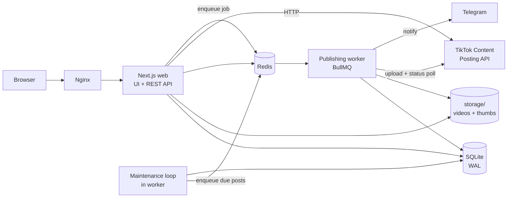
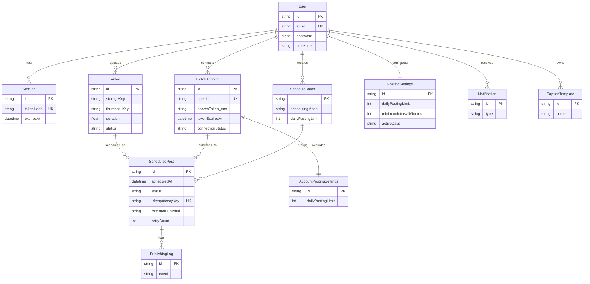
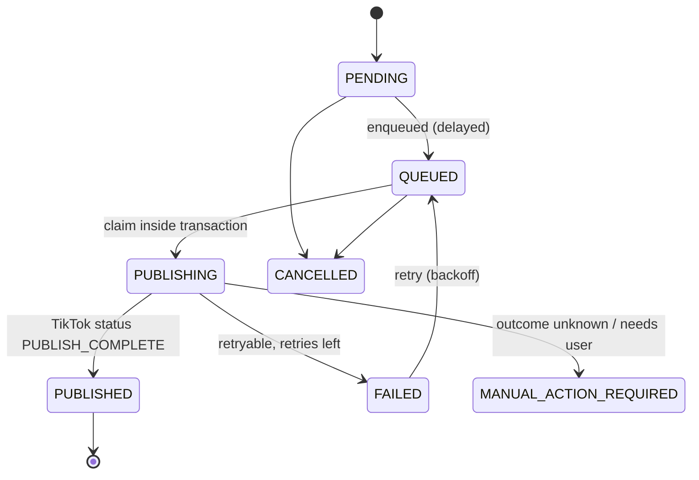

# SYSTEM_DESIGN — TikTok Scheduler

Automatic TikTok publishing on a schedule: bulk-upload videos, distribute them across a
constraint-aware calendar, and publish through the official TikTok Content Posting API from a
worker that runs 24/7 without a browser.

Status: design reference for the implementation. Phase state is tracked exclusively in
`IMPLEMENTATION_PLAN.md`; see `README.md` for operations.

---

## 1. Goals and non-goals

**Goals**

- Absorb 10–100+ uploads and place every one on a valid slot without manual math.
- Never exceed daily limits, minimum interval, active hours or active days.
- Publish unattended, once — duplicate publication is the failure mode that matters most.
- Survive worker restart, Redis flush and TikTok API errors without losing or repeating work.
- Run on a 1 vCPU / 1 GB VPS.

**Non-goals**

- Browser automation, unofficial endpoints, or any shortcut around TikTok review requirements.
- Guessing TikTok's own posting limits: the app enforces its *internal* limits and surfaces the
  API's rejections verbatim. Internal limits never override TikTok's.
- Multi-tenant SaaS hardening (billing, org roles). Single-user-per-account model, many users
  supported structurally.

---

## 2. Architecture

Deliberate choice: **one Next.js application serves UI *and* REST API** (`next start`), plus a
separate long-lived worker process. A separate NestJS service would duplicate auth, session and
Zod contracts across a network boundary for no benefit at this scale; the process separation that
actually matters — HTTP server vs. 24/7 publishing loop — is preserved. Scaling out later means
adding worker replicas, which the queue and DB locking already allow.

Layers:

| Layer | Package / app | Depends on |
|---|---|---|
| Pure scheduling engine | `packages/scheduler` | `shared` only (no IO, no clock except injected `now`) |
| Contracts (Zod, enums, time utils) | `packages/shared` | — |
| Data access, crypto, auth helpers | `packages/db` | `shared`, Prisma |
| TikTok OAuth + Content Posting client | `packages/tiktok` | `shared` |
| REST API routes | `apps/web/app/api/**` | `db`, `scheduler`, `shared`, `tiktok` |
| Dashboard UI | `apps/web/app/**`, `apps/web/components/**` | REST API only |
| Queue + publishing + maintenance | `apps/worker` | `db`, `scheduler`, `tiktok`, BullMQ |

Business logic never lives in React components: pages call REST endpoints, endpoints call
packages.

---

## 3. Data model (ERD)

SQLite has no enums or arrays: statuses are `TEXT` validated by Zod (`packages/shared/src/enums.ts`),
`activeDays` is a CSV of `0..6` (0 = Sunday), `postingTimes` and `scopes` are JSON/CSV strings.
All timestamps are stored in **UTC**; `scheduledAt` is an instant, and the user/account timezone is
kept alongside it so "which local day does this belong to" stays answerable after a policy change.

Indexes exist for the three hot access paths: due-job scan (`status, scheduledAt`), per-account
daily counting (`accountId, scheduledAt`), and library listing (`userId, status`).

### SQLite configuration

Configured in `packages/db/src/client.ts` on every connection:

- `journal_mode=WAL`, `synchronous=NORMAL` — concurrent reader (web) + writer (worker).
- `foreign_keys=ON` — cascade deletes are the only cleanup mechanism.
- `busy_timeout=10000` — writers queue instead of failing with `SQLITE_BUSY`.
- `connection_limit=1&pool_timeout=20` in the URL — SQLite has one writer; pooling more
  connections only buys lock contention.
- Transactions stay short; no HTTP call is ever made inside a transaction.
- Writers coordinate through a Redis lease (`SCHEDULE_LOCK`, `PUBLISH_LOCK`) before touching
  capacity, so a second worker cannot double-book a day.
- Backups: `VACUUM INTO` snapshots written by the worker's maintenance tick once a day into
  `data/backups/`, safe while readers are active; the newest `BACKUP_RETAIN` files are kept.

The DB file lives on a persistent local volume (`data/`). It must never sit on NFS/SMB.

---

## 4. Scheduling engine

Pure functions in `packages/scheduler`, no database, no clock (`now` is injected). Inputs are
constraints plus a count of videos; output is an ordered list of UTC instants each tagged with its
local date/time. That purity is what makes the hard cases testable: DST, month boundaries, active
days, capacity exhaustion.

Precedence when constraints conflict (highest first):

1. Active days (a slot on a disabled weekday is never produced).
2. Active hours (a slot outside `[start, end)` is never produced).
3. Daily posting limit (per-day capacity, per account and global, existing posts counted).
4. Minimum interval between posts on the same account (and, for `INTERVAL`, between slots).
5. Requested start date/time (earlier slots are skipped, never moved backwards).

Modes:

| Mode | Placement | Notes |
|---|---|---|
| `INTERVAL` | `startTime + n × intervalMinutes`, clamped to active hours, `dailyLimit` per day, then next active day | If `startTime + interval` exits the active window, the day's capacity ends there |
| `FIXED_TIME` | First `min(dailyLimit, postingTimes.length)` times of each active day | Surplus rolls to the next day (`3/day` of `20` videos ⇒ 7 days) |
| `CUSTOM` | Explicit `{date, time}` list, validated against limits | User order preserved; violations reported |
| `SMART` | `INTERVAL` with capacity derived from `(activeHours / interval)` per day | 100 videos, 5/day, 08–22, 2 h ⇒ 20 days |

Timezone conversion uses `Intl.DateTimeFormat` offset probing (`packages/shared/src/time.ts`), not
a date library: local wall-clock → UTC instant, with a second probe to land correctly on DST
transition days (nonexistent local times roll forward; ambiguous times take the first offset).

Recomputation: when limits or settings change, only `PENDING`/`QUEUED` posts are re-planned.
`PUBLISHED`, `PUBLISHING`, `CANCELLED` and `MANUAL_ACTION_REQUIRED` rows are immutable, and their
occupancy is fed back into the planner as already-consumed capacity.

---

## 5. Publishing pipeline and duplicate prevention

State machine of `ScheduledPost`:

Rules that make duplicates structurally unlikely:

1. **Atomic claim.** `UPDATE ... SET status='PUBLISHING', lockedBy=?, attemptStartedAt=? WHERE
   id=? AND status='QUEUED'` — zero rows updated means someone else owns it; the job exits.
   Protected additionally by a Redis lease per post and a BullMQ `jobId` of `publish-<postId>`
   (BullMQ rejects `:` inside custom job ids), so two workers cannot hold the same post.
2. **One job per post.** BullMQ `jobId` is deterministic. Rescheduling removes the old job *then*
   re-adds it; removal failure is retried before the new schedule is committed.
3. **Unknown outcome never retries blindly.** If the HTTP request may have reached TikTok but no
   `publish_id` was persisted (crash, timeout, 5xx), the post is moved to
   `MANUAL_ACTION_REQUIRED` with an explicit reason. The operator checks TikTok, then either
   marks it published or returns it to the queue. The worker only auto-retries failures that are
   provably *before* submission (auth, validation, missing file, rate limit with a conclusive
   response).
4. **Status polling.** Direct Post: `POST /v2/post/publish/status/fetch/` with `publish_id`, polled
   with exponential backoff up to the job timeout; `FAILED` from TikTok is terminal for the attempt
   and logged with the API error code.
5. **Capacity is re-checked at publish time**, not only at plan time: the claim transaction counts
   today's published posts per account and globally, so an externally changed limit cannot leak
   extra posts.

Retry policy: exponential backoff (`30 s × 2^attempt`, capped at 1 h), `maxRetries` per post,
failures beyond retries land in the dead-letter queue plus a `FAILED` row and notification. A
failed post never blocks later posts.

Reliability features: publish job timeout, stalled-job detection, graceful shutdown (stop taking
jobs, finish in-flight, close connections), recovery on boot (requeue `PUBLISHING` rows older than
the timeout, rehydrate delayed jobs from SQLite as the source of truth), and a 30 s maintenance
loop that enqueues posts whose `scheduledAt` has passed — SQLite, not Redis, is authoritative, so a
Redis flush cannot lose the schedule.

---

## 6. TikTok integration

Official Content Posting API only (`packages/tiktok`):

- OAuth 2.0 authorization-code flow (`/v2/auth/authorize/`, `/v2/oauth/token/`), PKCE not offered
  by TikTok; `state` is a signed, single-use value stored in an HTTP-only cookie.
- Access token TTL is 24 h; refresh token 365 d. Refreshing happens proactively before a publish
  attempt and on `401`, with a per-account Redis lock so concurrent jobs do not invalidate each
  other. Tokens are encrypted at rest (AES-256-GCM).
- Creator Info (`/v2/post/publish/creator_info/query/`) is queried immediately before every publish
  to obtain `max_video_post_duration_sec`, allowed privacy levels and interaction flags.
- Two publishing methods, chosen per post:
  - `DIRECT_POST` — `/v2/post/publish/video/init/` with `post_info`; requires TikTok's Direct Post
    audit for the app.
  - `UPLOAD_DRAFT` (inbox) — `/v2/post/publish/inbox/video/init/`; the creator finishes the post in
    the TikTok app. When this path is used the UI states *explicitly* that publication is completed
    by the user inside TikTok, and the post is not marked published until the status API says so.

Documented limitations (surfaced in the UI and `README.md`):

- An unaudited app can only publish to accounts added as test users, and only as `SELF_ONLY`
  (private). Direct Post waits for app review.
- `video.publish` scope must be approved; without it, the pipeline runs in `mock` mode only.
- Rate limits are per-client (`429` with `retry-after`); the client honours it.
- TikTok rejects videos outside its codec/duration/size rules; validation happens before upload.

Never claimed: "auto-post works in production" until exercised against the live API with an
approved app. Mock mode is the default for development and for the test suite.

---

## 7. Video pipeline

Upload request only streams bytes to a temp file and creates the `Video` row as `PROCESSING`; it
never blocks on FFmpeg. A `PROCESS_VIDEO` job then runs `ffprobe` (duration, resolution, codec) and
`ffmpeg` (JPEG thumbnail at 1 s), writes `READY` or `FAILED + processingError`. Validation before
storage: MIME sniffing on the first 4 kB (not the client-declared type), extension allow-list
(`mp4|mov|webm`), size limit from `MAX_UPLOAD_SIZE_MB`, and an `ffprobe` success check to reject
corrupt files. Thumbnails and videos are served by an authenticated route, never as static files,
so one user cannot read another's media. Parallel client uploads are capped by
`UPLOAD_CONCURRENCY`.

---

## 8. Security

- Passwords: `scrypt` (N=16384, r=8, p=1) with 16-byte salt, constant-time compare. Node's stdlib
  KDF chosen over bcrypt/Argon2 to avoid a native build step in the container; both are
  memory-hard-equivalent for this threat model.
- Sessions: 32-byte random token in an HTTP-only, `SameSite=Lax`, `Secure` (in production) cookie;
  only its SHA-256 is stored, so a DB leak cannot be replayed. Server-side revocation on logout.
- CSRF: state-changing API routes require `SameSite=Lax` cookie plus an `Origin` check against
  `APP_URL`; uploads and JSON mutations reject cross-origin requests.
- Token encryption: AES-256-GCM per record with a random IV and a key from `TOKEN_ENCRYPTION_KEY`;
  ciphertext+IV+tag stored as one base64 string.
- Authorization: every query is scoped by `userId` from the session; ownership is checked before any
  mutation or media read.
- Rate limiting: Redis sliding-window per IP+route for auth (5/min) and general API (120/min).
- Validation: one Zod schema per endpoint, shared with the client form where possible.
- Audit: `PublishingLog` records each publish attempt's sanitized request/response metadata;
  `Notification` records user-facing events. Tokens are redacted in logs.

---

## 9. Deployment

`docker-compose.yml` runs `web`, `worker`, `redis` and `nginx`; `data/` and `storage/` are host
bind mounts (persistent volumes). SQLite lives only on the web container's local volume, shared
with the worker through the same mount — one writer process each, WAL, and Redis leases for
coordination. Health: `GET /api/health` (DB + Redis + queue depth), worker `/health` via heartbeat
row/Redis key. Logs: single-line JSON to stdout (`web`, `worker`). Nginx terminates TLS (Let's
Encrypt), proxies `/api` and `/` to the web container and enforces a 300 MB body limit.

Backup: nightly `VACUUM INTO data/backups/<timestamp>.db` plus `storage/` rsync; documented restore
procedure in `README.md`.

---

## 10. Testing strategy

| Area | Where | What it proves |
|---|---|---|
| Scheduler | `packages/scheduler/test/*.test.ts` | interval/fixed/custom/smart, daily caps, global vs per-account, active days/hours, timezone + DST, day boundaries, occupancy from existing posts |
| Time utils | `packages/shared/test/time.test.ts` | wall-clock → UTC round-trips, DST gaps/overlaps, fixed-offset zones |
| TikTok client | `packages/tiktok/test/*.test.ts` | OAuth URL/exchange/refresh, direct-post + inbox init, status polling, error mapping, retry-after |
| Worker | `apps/worker/test/*.test.ts` | claim-once semantics, publish-id persistence, polling to PUBLISHED, no duplicate publish, notifications/logs |
| Auth/API + routes | live smoke (no suite yet) | register, OAuth callback (mock), upload, schedule generate, publish, stats, notifications, health — exercised against a running web app + worker |

Vitest for the pure and pipeline layers; `TIKTOK_API_MODE=mock` for anything touching TikTok, with
the fake API hosted in-process so tests never reach the network. REST handlers are covered by the
live smoke described in `.agile/<scope>/verification-*.md`; a per-route suite is the open gap.